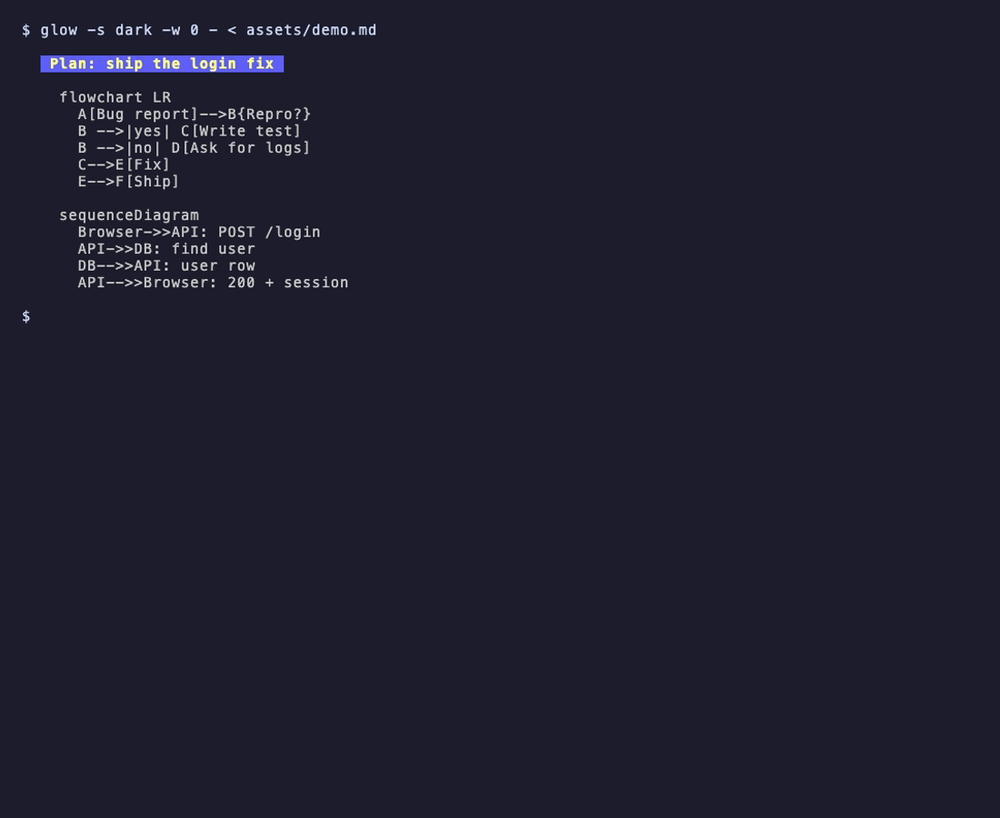
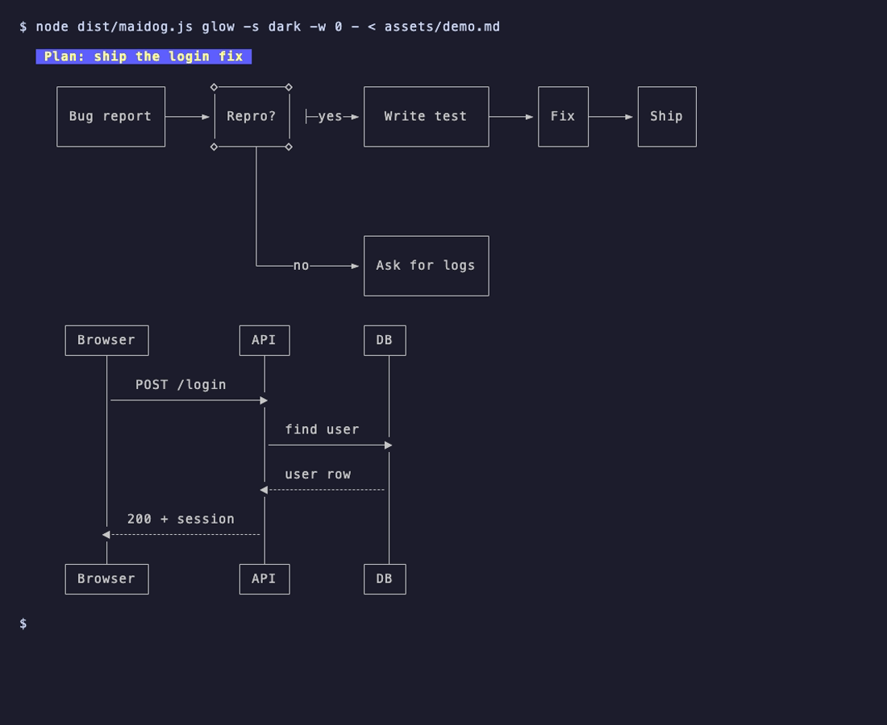
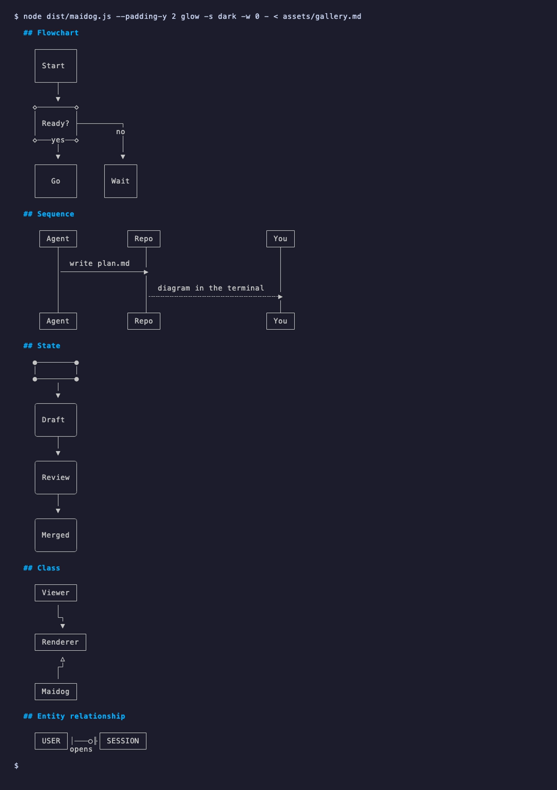

# maidog

Mermaid diagrams, right in your terminal.

[](https://github.com/dynaum/maidog/actions/workflows/ci.yml)
[](https://www.npmjs.com/package/maidog)
[](LICENSE)
[](https://herdr.dev/plugins/)

Your agent wrote a plan with a diagram. Your terminal shows you this:



With maidog, you see this:



Same file. Same viewer. One extra word in front of the command.

## Why maidog

- Coding agents write Mermaid in plans, specs, and READMEs every day.
- Terminal markdown viewers show those blocks as code, so you open a browser to read a picture.
- maidog draws each diagram as Unicode box art where the code block was.
- No browser, no image protocol, no GPU. Works in any terminal, over SSH, and inside tmux or herdr.
- Diagrams render in about 100 ms, so the tool stays out of your way.

## Set up herdr in 30 seconds

```bash
herdr plugin install dynaum/maidog
herdr plugin action invoke maidog.setup-file-viewer
```

Open any markdown file in [herdr-file-viewer](https://github.com/smarzban/herdr-file-viewer) 1.12.0 or newer and the diagrams are there. The setup action changes one line in the viewer's config and keeps a backup. Read [docs/herdr.md](docs/herdr.md) for the full guide.

## Use maidog anywhere

maidog reads markdown on stdin. Print the result, or hand it to the viewer you already use.

```bash
npx maidog < plan.md                      # print markdown with diagrams drawn
npx maidog glow -s dark -w 0 - < plan.md  # render with glow
npx maidog less -R < plan.md              # page through it
```

Install with `npm install -g maidog`, or grab a single binary with no runtime needed:

```bash
curl -fsSL -o maidog https://github.com/dynaum/maidog/releases/latest/download/maidog-$(uname -s | tr A-Z a-z)-$(uname -m | sed 's/x86_64/x64/;s/aarch64/arm64/')
chmod +x maidog && sudo mv maidog /usr/local/bin/
```

Every flag and recipe lives in [docs/cli.md](docs/cli.md).

## What renders



| Diagram | Renders | Notes |
|---|---|---|
| `flowchart` / `graph` | Yes | All directions, edge labels, dotted and thick arrows |
| `sequenceDiagram` | Yes | Solid and dashed messages |
| `stateDiagram-v2` | Yes | Start and end states |
| `classDiagram` | Yes | Members show when each sits on its own line. One-line bodies such as `class A { +run() }` drop them. |
| `erDiagram` | Yes | Crow's foot relations |
| `gantt`, `pie`, `mindmap`, `timeline` | Not yet | The source stays as is, with a one-line note |

## Built for messy, real-world diagrams

Agents do not write textbook Mermaid. maidog fixes the common slips before drawing:

- `A-->B` with no spaces
- `A --> |label| B` with a space before the label
- `<b>`, `<i>`, and `<br>` tags inside labels
- YAML frontmatter at the top of the block
- `flowchart` with no direction, or a trailing `;` on the header

When maidog meets a diagram beyond its reach, the code stays in place with a short note below. Your document never loses content.

## Safe by default

- maidog reads stdin and writes stdout. Your files stay untouched.
- maidog strips escape and control bytes from diagram labels, so a hostile file never drives your terminal.
- maidog skips diagrams over 300 lines or 20,000 characters, so a huge block never stalls your viewer.

[docs/how-it-works.md](docs/how-it-works.md) walks through the whole pipeline.

## Credits

- [beautiful-mermaid](https://github.com/lukilabs/beautiful-mermaid) draws the diagrams.
- [herdr-file-viewer](https://github.com/smarzban/herdr-file-viewer) is the viewer maidog plugs into.
- [herdr](https://herdr.dev) is the terminal workspace for coding agents.

## License

MIT. See [LICENSE](LICENSE).
