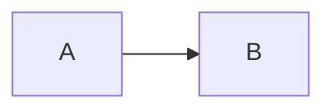
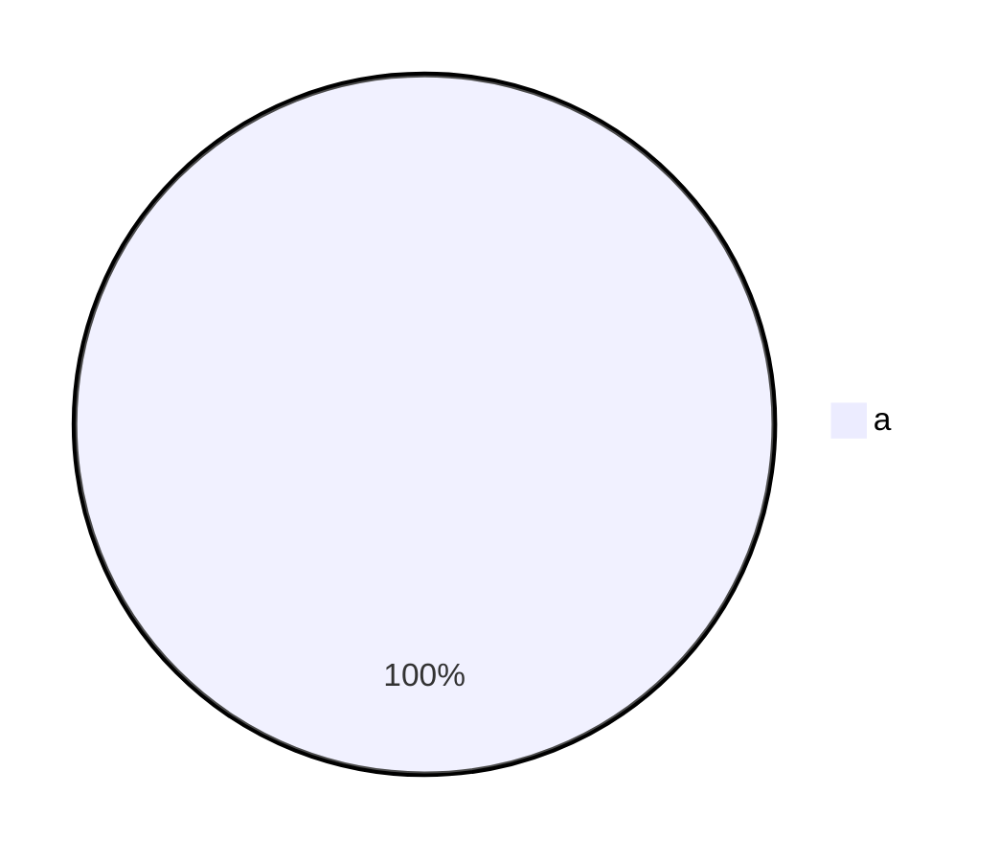

# maidog CLI

maidog reads markdown on stdin, draws every Mermaid block as Unicode box art, and writes the result to stdout or into a command you name.

## Install

| Method | Command | Needs |
|---|---|---|
| npx | `npx maidog < plan.md` | Node 18+ |
| npm | `npm install -g maidog` | Node 18+ |
| Bun | `bunx maidog < plan.md` | Bun |
| Binary | Download `maidog-<os>-<arch>` from [Releases](https://github.com/dynaum/maidog/releases) | Nothing |
| Source | `git clone https://github.com/dynaum/maidog && cd maidog && bun install && bun run bundle` | Bun |

Binaries exist for `darwin-arm64`, `darwin-x64`, `linux-x64`, and `linux-arm64`. Each release ships a `SHA256SUMS` file. Check a download with:

```bash
shasum -a 256 -c SHA256SUMS --ignore-missing
```

## Usage

```text
maidog [options] < file.md                 print markdown with diagrams rendered
maidog [options] <command> [args...]       pipe the result into <command>
maidog herdr setup [--force]               wire herdr-file-viewer to maidog
maidog herdr refresh                       re-copy the runtime after an update
```

## Options

| Option | Default | Effect |
|---|---|---|
| `--ascii` | off | Draw with `+ - \| >` instead of box-drawing characters. Use this for fonts or terminals without box glyphs. |
| `--max-width <cols>` | `0` (no limit) | Keep diagrams wider than `<cols>` as source, with a note. |
| `--padding-x <n>` | `5` | Horizontal space between nodes. |
| `--padding-y <n>` | `5` | Vertical space between nodes. Lower values give compact diagrams. |
| `-h`, `--help` | | Show help. |
| `-V`, `--version` | | Show the version. |

Examples:

```bash
maidog --ascii < plan.md
maidog --max-width 100 < plan.md
maidog --padding-x 2 --padding-y 2 < plan.md
```

`--opt=value` works too: `maidog --max-width=100 < plan.md`.

## Piping into another command

Options come first. The first word without a leading dash starts the command, and maidog passes the rest through untouched:

```bash
maidog --ascii glow -s dark -w 0 - < plan.md
#      ^^^^^^^ maidog option
#              ^^^^^^^^^^^^^^^^^^^^ glow command, untouched
```

Put `--` in front when the command name looks like an option or matches `herdr`:

```bash
maidog -- herdr-something --flag < plan.md
```

maidog sends the transformed markdown to the command's stdin and lets the command write straight to your terminal.

## Exit codes

| Code | Meaning |
|---|---|
| `0` | Success, or the downstream command exited 0 |
| `1` | Unexpected error |
| `2` | Bad option. maidog prints the problem and `Run maidog --help for usage.` |
| `126` | The downstream command exists but would not start |
| `127` | The downstream command was not found |
| other | Passed through from the downstream command |

A diagram beyond maidog's reach is not an error. The block stays as source with a note below, and the exit code stays `0`.

## Recipes

### glow

```bash
maidog glow -s dark -w 0 - < plan.md   # print
maidog glow -s dark -p - < plan.md     # page
```

### less

```bash
maidog < plan.md | less -R
```

### bat

```bash
maidog < plan.md | bat -l md
```

### A shell shortcut

Add to `~/.zshrc` or `~/.bashrc`:

```bash
mdv() { maidog glow -s dark -p - < "$1"; }
```

Then run `mdv plan.md`.

## What the output looks like

Input:

````markdown

````

Output:

````markdown
```text
┌───┐     ┌───┐
│   │     │   │
│ A ├────►│ B │
│   │     │   │
└───┘     └───┘
```
````

maidog wraps each diagram in a `text` code block, so any markdown viewer keeps the spacing.

A block maidog cannot draw stays as is:

````markdown


> maidog: pie diagrams are not supported yet
````
