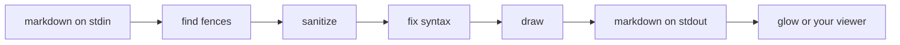

# How maidog works

maidog is a filter. Markdown goes in on stdin, markdown comes out on stdout. The only change: each Mermaid block becomes a `text` block with the diagram drawn in box characters.

Open this file with maidog and the block above draws itself.

## 1. Find the fences

maidog walks the file line by line and follows the CommonMark rules for fenced code:

- Backtick or tilde fences, three characters or more.
- Up to three spaces of indent. maidog keeps the indent in the output, so diagrams inside list items stay in place.
- The info string must start with `mermaid`, in any case. `mermaid title="x"` and `Mermaid` both count.
- A fence closes only with the same character, at least as long as the opener.
- A Mermaid block nested inside a longer outer fence stays literal. Docs that show Mermaid source keep showing source.
- An unclosed fence runs to the end of the file, as in CommonMark, and maidog leaves the block alone.
- CRLF files stay CRLF.

## 2. Sanitize

maidog deletes every control byte from the diagram source except tab and newline. That covers escape sequences, bells, and the C1 range. A label cannot clear your screen or move your cursor. maidog runs the same pass over the drawn output.

## 3. Fix the syntax

maidog draws with [beautiful-mermaid](https://github.com/lukilabs/beautiful-mermaid). Its parser rejects or misreads some syntax real Mermaid accepts. maidog rewrites flowcharts before drawing:

| Input | Problem upstream | maidog sends |
|---|---|---|
| `A-->B` | Parsed as one node named `A--` ([#140](https://github.com/lukilabs/beautiful-mermaid/issues/140)) | `A --> B` |
| `A --> \|yes\| B` | Drops node `B` ([#155](https://github.com/lukilabs/beautiful-mermaid/issues/155)) | `A -->\|yes\| B` |
| `A[<b>Bold</b>]` | Prints the tags ([#137](https://github.com/lukilabs/beautiful-mermaid/issues/137)) | `A[Bold]` |
| `---` frontmatter | Rejects the block | Block without frontmatter |
| `flowchart` with no direction | Rejects the block | `flowchart TD` |
| `flowchart LR;` | Rejects the block | `flowchart LR` |

The rewrite never changes text inside quotes, brackets, or `|labels|`. `A["a-->b"]` keeps its label. Comment lines (`%%`) and style lines (`classDef`, `style`, `linkStyle`, `class`, `click`) pass through untouched. Other diagram types pass through as written, minus frontmatter.

## 4. Draw

beautiful-mermaid lays out the diagram and returns text. maidog trims trailing spaces and wraps the result in a `text` fence. When the diagram itself contains backticks, the fence grows longer so markdown stays valid.

When a width applies (`--max-width`, or glow's `-w`), maidog tries layouts in order and keeps the first one that fits:

1. The diagram as written.
2. A left-right flowchart turned top-down (`LR` to `TD`, `RL` to `BT`).
3. The same two with horizontal spacing cut to 2.
4. The same two with spacing cut to 1 across and 2 down.

maidog draws in a child process. The parent stops it after the time limit (3 seconds by default) and keeps every diagram finished by then. beautiful-mermaid's layout runs for 12 seconds on a single 25-step chain, so the limit matters.

## 5. Fall back

maidog never drops content. When a block cannot be drawn, the original block stays and one note follows it:

| Note | Cause |
|---|---|
| `> maidog: gantt diagrams are not supported yet` | Type outside flowchart, sequence, state, class, ER |
| `> maidog: could not parse diagram (...)` | The parser threw. The first line of the parser's message follows. |
| `> maidog: renderer returned an empty diagram` | The parser accepted the block but drew nothing |
| `> maidog: empty diagram` | The block holds only blank lines or comments |
| `> maidog: diagram too large to render (limit 300 lines or 20000 characters)` | Size cap |
| `> maidog: diagram needs N columns but only M fit. Widen the pane or view it full width.` | No layout fits the width |
| `> maidog: diagram took too long to draw (over 3 s)` | Time limit |

## Security model

- Content arrives on stdin only. maidog never reads a path from the document.
- maidog strips control bytes from diagram source and output.
- maidog draws in a child process and stops the child after 3 seconds, inside herdr-file-viewer's 5 second renderer limit. The size cap also bounds layout work.
- herdr-file-viewer strips everything except color codes from renderer output, so the viewer adds a second layer of protection.
- `maidog herdr setup` writes two places only: its own state folder and the viewer's config file, after a backup.
