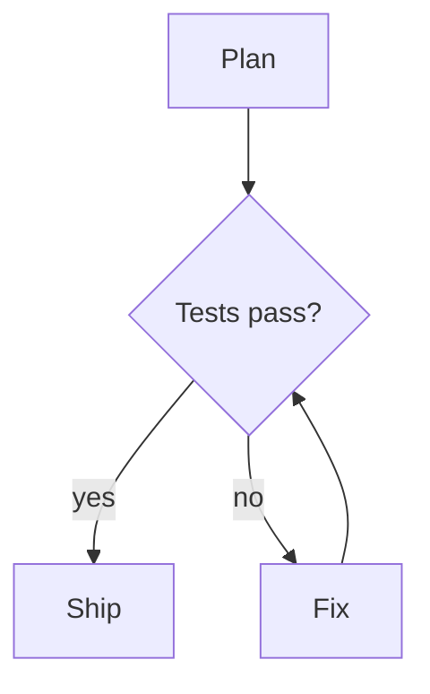
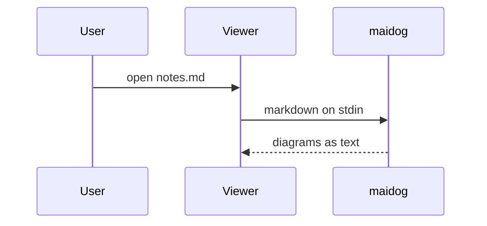
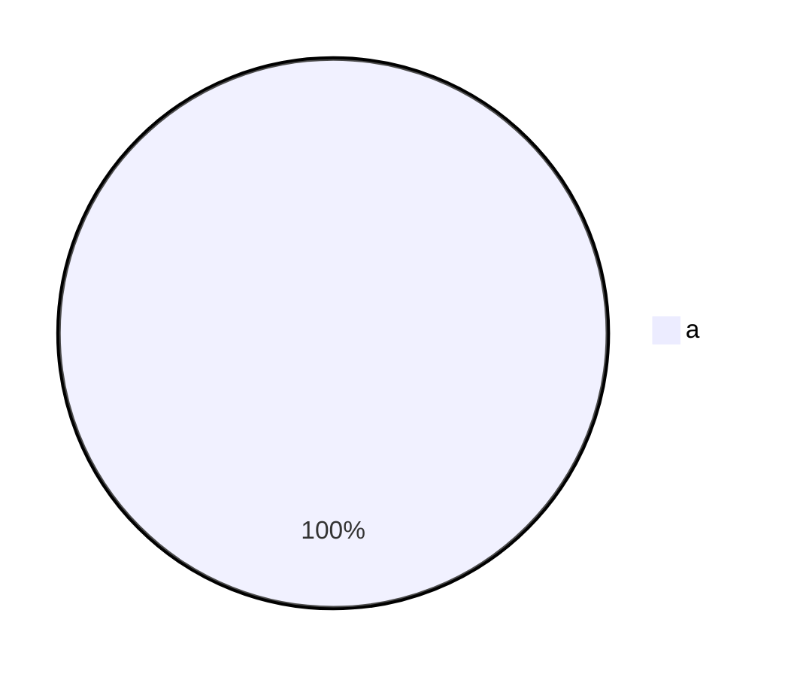

# maidog Implementation Plan

> **For agentic workers:** REQUIRED SUB-SKILL: Use superpowers:subagent-driven-development (recommended) or superpowers:executing-plans to implement this plan task-by-task. Steps use checkbox (`- [ ]`) syntax for tracking.

**Goal:** Ship `maidog`, a markdown filter CLI and herdr plugin that renders Mermaid fences as Unicode diagrams in the terminal, with marketing-grade docs.

**Architecture:** A pure TypeScript core (fence scanner → source sanitizer → syntax normalizer → beautiful-mermaid ASCII renderer) behind a thin CLI that writes to stdout or pipes into a downstream command. A `herdr` subcommand copies the runtime to a stable directory and wires `herdr-file-viewer`'s `markdown` renderer to it. The bundle targets Node so the same file runs under Node 18+, Bun, or as a Bun-compiled binary.

**Tech Stack:** TypeScript, Bun 1.3 (test runner, bundler, `--compile`), Node 18+ runtime APIs only (`node:child_process`, `node:fs`), beautiful-mermaid 1.1.3 (MIT), glow (downstream), vhs (screenshots), GitHub Actions.

**Spec:** `docs/superpowers/specs/2026-10-09-maidog-design.md`

## Global Constraints

- Repo root: `/Users/dynaum/dev/herdr/maidog`. GitHub: `dynaum/maidog`. License MIT.
- Runtime code imports only `node:*` modules and `beautiful-mermaid`. No Bun-only APIs in `src/` (the bundle must run on Node 18+).
- `herdr-plugin.toml`: `id = "maidog"`, `min_herdr_version = "0.7.5"`, `platforms = ["linux", "macos"]`.
- Size cap per diagram: 300 lines or 20,000 characters.
- Supported types: `graph`, `flowchart`, `sequenceDiagram`, `classDiagram`, `stateDiagram`, `stateDiagram-v2`, `erDiagram`.
- Fallback note format: a blank line, then `> maidog: <reason>` directly after the untouched original block.
- Missing downstream command: stderr `maidog: command not found: <name>`, exit 127. Bad option: stderr `maidog: <message>` plus `Run maidog --help for usage.`, exit 2.
- Never write inside `$HERDR_PLUGIN_ROOT` at runtime. The viewer config must point at `<state-dir>/runtime/maidog`.
- Docs prose follows the user's writing rules: short active sentences, no em dashes, no semicolons, no hype words.

## Review Focus

1. A Mermaid fence nested inside a longer outer fence (docs that show Mermaid source) must stay literal. Test in Task 1.
2. Arrow-like text inside quotes or brackets (`A["a-->b"]`) must survive normalization unchanged. Test in Task 2.
3. CRLF files, tilde fences, indented fences, and info strings such as `mermaid title="x"` must still render, and CRLF must survive in the output. Test in Task 1.
4. Escape and control bytes inside labels must never reach the terminal. Test in Task 3.
5. The downstream command exiting early (for example `maidog head -1`) must not crash maidog with EPIPE. Test in Task 4.

---

## File Structure

```text
maidog/
  package.json              npm metadata, bin, scripts
  tsconfig.json
  .gitignore
  LICENSE
  herdr-plugin.toml         herdr manifest (Task 7)
  dist/maidog.js            committed Node bundle (Task 6)
  src/
    fences.ts               fence scanner + replacement (Task 1)
    normalize.ts            sanitize + flowchart syntax fixes (Task 2)
    render.ts               one block → BlockResult (Task 3)
    transform.ts            transformMarkdown(md, options) glue (Task 3)
    args.ts                 argv parsing (Task 4)
    pipe.ts                 downstream process runner (Task 4)
    cli.ts                  entrypoint (Task 4)
    herdr/
      viewer-config.ts      pure TOML line upsert (Task 5)
      paths.ts              config/state path resolution (Task 5)
      setup.ts              setup/refresh side effects (Task 5)
  scripts/
    build-plugin.sh         herdr install-time build (Task 7)
    run.sh                  runtime selector used by actions (Task 7)
    preview.sh              popup preview (Task 7)
  test/
    fences.test.ts  normalize.test.ts  render.test.ts  transform.test.ts
    args.test.ts  cli.test.ts  viewer-config.test.ts  setup.test.ts
    fixtures/sample.md
  assets/tapes/*.tape, assets/*.png  (Task 8)
  docs/cli.md docs/herdr.md docs/how-it-works.md  (Task 8)
  README.md CONTRIBUTING.md CHANGELOG.md  (Task 8)
  .github/workflows/ci.yml release.yml  (Task 6)
```

---

### Task 0: Scaffold

**Files:**
- Create: `package.json`, `tsconfig.json`, `.gitignore`, `LICENSE`

- [ ] **Step 1: Write scaffold files**

`package.json`:

```json
{
  "name": "maidog",
  "version": "0.1.0",
  "description": "Render Mermaid diagrams as Unicode art in your terminal markdown viewer.",
  "license": "MIT",
  "author": "Elber Ribeiro <elber@dynaum.com>",
  "repository": { "type": "git", "url": "git+https://github.com/dynaum/maidog.git" },
  "homepage": "https://github.com/dynaum/maidog#readme",
  "keywords": ["mermaid", "markdown", "terminal", "ascii", "glow", "herdr", "cli"],
  "type": "module",
  "bin": { "maidog": "dist/maidog.js" },
  "files": ["dist/maidog.js", "README.md", "LICENSE"],
  "engines": { "node": ">=18" },
  "scripts": {
    "test": "bun test",
    "typecheck": "tsc --noEmit",
    "bundle": "bun build src/cli.ts --target node --minify --banner '#!/usr/bin/env node' --outfile dist/maidog.js",
    "check": "bun run typecheck && bun test && bun run bundle && git diff --exit-code dist/maidog.js"
  },
  "dependencies": { "beautiful-mermaid": "1.1.3" },
  "devDependencies": { "@types/node": "^22", "@types/bun": "latest", "typescript": "^5.6" }
}
```

`tsconfig.json`:

```json
{
  "compilerOptions": {
    "target": "ES2022",
    "module": "ESNext",
    "moduleResolution": "Bundler",
    "strict": true,
    "noEmit": true,
    "resolveJsonModule": true,
    "types": ["node", "bun"],
    "skipLibCheck": true
  },
  "include": ["src", "test"]
}
```

`.gitignore`:

```text
node_modules/
dist/bin/
*.log
.DS_Store
```

`LICENSE`: standard MIT text, `Copyright (c) 2026 Elber Ribeiro`.

- [ ] **Step 2: Install and verify**

Run: `cd /Users/dynaum/dev/herdr/maidog && bun install && bunx tsc --version`
Expected: install succeeds, prints a TypeScript 5.x version.

- [ ] **Step 3: Commit**

```bash
git add package.json tsconfig.json .gitignore LICENSE bun.lock docs/
git commit -m "chore: scaffold maidog"
```

---

### Task 1: Fence scanner

**Files:**
- Create: `src/fences.ts`
- Test: `test/fences.test.ts`

**Interfaces:**
- Produces:
  - `export type BlockResult = { ok: true; text: string } | { ok: false; reason: string }`
  - `export type BlockRenderer = (source: string) => BlockResult`
  - `export function replaceMermaidFences(markdown: string, render: BlockRenderer): string`

- [ ] **Step 1: Write the failing tests**

```ts
import { describe, expect, test } from "bun:test";
import { replaceMermaidFences, type BlockRenderer } from "../src/fences";

const upper: BlockRenderer = (src) => ({ ok: true, text: src.toUpperCase() });
const fail: BlockRenderer = () => ({ ok: false, reason: "nope" });

describe("replaceMermaidFences", () => {
  test("replaces a backtick mermaid fence with a text fence", () => {
    const md = "# T\n\n```mermaid\ngraph LR\n  a --> b\n```\n\nafter\n";
    expect(replaceMermaidFences(md, upper)).toBe(
      "# T\n\n```text\nGRAPH LR\n  A --> B\n```\n\nafter\n",
    );
  });

  test("handles tilde fences, info attributes and uppercase language", () => {
    const md = '~~~~ Mermaid title="x"\ngraph LR\n~~~~\n';
    expect(replaceMermaidFences(md, upper)).toBe("```text\nGRAPH LR\n```\n");
  });

  test("keeps the indent of an indented fence and dedents the body", () => {
    const md = "- item\n\n   ```mermaid\n   graph LR\n   ```\n";
    expect(replaceMermaidFences(md, upper)).toBe("- item\n\n   ```text\n   GRAPH LR\n   ```\n");
  });

  test("leaves non-mermaid fences untouched", () => {
    const md = "```js\nconst a = 1\n```\n";
    expect(replaceMermaidFences(md, upper)).toBe(md);
  });

  test("leaves a mermaid fence nested in a longer outer fence untouched", () => {
    const md = "````markdown\n```mermaid\ngraph LR\n```\n````\n";
    expect(replaceMermaidFences(md, upper)).toBe(md);
  });

  test("leaves an unclosed mermaid fence untouched", () => {
    const md = "```mermaid\ngraph LR\n";
    expect(replaceMermaidFences(md, upper)).toBe(md);
  });

  test("keeps the original block and appends a note on failure", () => {
    const md = "```mermaid\ngantt\n```\nnext\n";
    expect(replaceMermaidFences(md, fail)).toBe("```mermaid\ngantt\n```\n\n> maidog: nope\nnext\n");
  });

  test("preserves CRLF line endings", () => {
    const md = "```mermaid\r\ngraph LR\r\n```\r\n";
    expect(replaceMermaidFences(md, upper)).toBe("```text\r\nGRAPH LR\r\n```\r\n");
  });

  test("uses a longer output fence when the diagram contains backticks", () => {
    const tick: BlockRenderer = () => ({ ok: true, text: "a ``` b" });
    expect(replaceMermaidFences("```mermaid\nx\n```\n", tick)).toBe("````text\na ``` b\n````\n");
  });

  test("a backtick fence whose info string has a backtick is not a fence", () => {
    const md = "```mermaid `x`\ngraph LR\n```\n";
    expect(replaceMermaidFences(md, upper)).toBe(md);
  });
});
```

- [ ] **Step 2: Run tests to verify they fail**

Run: `bun test test/fences.test.ts`
Expected: FAIL, cannot find module `../src/fences`.

- [ ] **Step 3: Implement**

```ts
// Finds CommonMark fenced code blocks and swaps mermaid ones for rendered text fences.
export type BlockResult = { ok: true; text: string } | { ok: false; reason: string };
export type BlockRenderer = (source: string) => BlockResult;

const OPEN = /^( {0,3})(`{3,}|~{3,})(.*)$/;
const MERMAID_INFO = /^mermaid(?=$|[\s{:])/i;

export function replaceMermaidFences(markdown: string, render: BlockRenderer): string {
  const eol = markdown.includes("\r\n") ? "\r\n" : "\n";
  const lines = markdown.split(/\r?\n/);
  const out: string[] = [];
  let i = 0;
  while (i < lines.length) {
    const open = OPEN.exec(lines[i]);
    if (!open) {
      out.push(lines[i++]);
      continue;
    }
    const [, indent, fence, rest] = open;
    const info = rest.trim();
    if (fence[0] === "`" && info.includes("`")) {
      out.push(lines[i++]);
      continue;
    }
    const close = new RegExp(`^ {0,3}${fence[0] === "`" ? "`" : "~"}{${fence.length},}\\s*$`);
    let j = i + 1;
    while (j < lines.length && !close.test(lines[j])) j++;
    if (j >= lines.length) {
      // Unclosed fence: CommonMark runs it to the end of the document.
      out.push(...lines.slice(i));
      break;
    }
    const block = lines.slice(i, j + 1);
    if (!MERMAID_INFO.test(info)) {
      out.push(...block);
    } else {
      const body = lines.slice(i + 1, j).map((l) => dedent(l, indent.length)).join("\n");
      const result = render(body);
      if (result.ok) {
        const ticks = "`".repeat(Math.max(3, longestBacktickRun(result.text) + 1));
        out.push(`${indent}${ticks}text`);
        for (const line of result.text.split("\n")) out.push(indent + line);
        out.push(`${indent}${ticks}`);
      } else {
        out.push(...block, "", `${indent}> maidog: ${result.reason}`);
      }
    }
    i = j + 1;
  }
  return out.join(eol);
}

function dedent(line: string, n: number): string {
  let k = 0;
  while (k < n && line[k] === " ") k++;
  return line.slice(k);
}

function longestBacktickRun(text: string): number {
  let best = 0;
  for (const m of text.matchAll(/`+/g)) best = Math.max(best, m[0].length);
  return best;
}
```

- [ ] **Step 4: Run tests to verify they pass**

Run: `bun test test/fences.test.ts`
Expected: 10 pass, 0 fail.

- [ ] **Step 5: Commit**

```bash
git add src/fences.ts test/fences.test.ts
git commit -m "feat: scan markdown fences and swap mermaid blocks"
```

---

### Task 2: Sanitizer and flowchart normalizer

**Files:**
- Create: `src/normalize.ts`
- Test: `test/normalize.test.ts`

**Interfaces:**
- Produces:
  - `export function sanitizeSource(src: string): string` (strips C0 controls except `\t` `\n`, plus DEL and C1 `\u0080-\u009f`)
  - `export function normalizeMermaid(src: string): string` (strips frontmatter, applies flowchart fixes, leaves other types alone apart from frontmatter)

- [ ] **Step 1: Write the failing tests**

```ts
import { describe, expect, test } from "bun:test";
import { normalizeMermaid, sanitizeSource } from "../src/normalize";

describe("sanitizeSource", () => {
  test("strips escape and control bytes but keeps tabs and newlines", () => {
    expect(sanitizeSource("a\u001b[31mb\u0007\tc\nd\u007f\u009b")).toBe("a[31mb\tc\nd");
  });
});

describe("normalizeMermaid", () => {
  const n = (body: string) => normalizeMermaid(`flowchart LR\n${body}`).split("\n").slice(1).join("\n");

  test("adds spaces around tight arrows", () => {
    expect(n("  A-->B")).toBe("  A --> B");
    expect(n("  A==>B")).toBe("  A ==> B");
    expect(n("  A-.->B")).toBe("  A -.-> B");
    expect(n("  A<-->B")).toBe("  A <--> B");
    expect(n("  A---B")).toBe("  A --- B");
  });

  test("glues the edge label to the arrow", () => {
    expect(n("  A --> |yes| B")).toBe("  A -->|yes| B");
    expect(n("  A-->|yes|B")).toBe("  A -->|yes| B");
  });

  test("keeps text-on-edge syntax valid", () => {
    expect(n("  A-- text -->B")).toBe("  A -- text --> B");
  });

  test("never touches quoted or bracketed text", () => {
    expect(n('  A["a-->b"]-->B(c-->d)')).toBe('  A["a-->b"] --> B(c-->d)');
    expect(n("  A{x==>y}-->B")).toBe("  A{x==>y} --> B");
  });

  test("drops inline formatting tags and turns <br> into a space", () => {
    expect(n("  A[<b>Bold</b> <i>it</i><br/>x] --> B")).toBe("  A[Bold it x] --> B");
  });

  test("leaves style and comment lines alone", () => {
    expect(n("  %% A-->B\n  classDef x stroke-width:2px")).toBe("  %% A-->B\n  classDef x stroke-width:2px");
  });

  test("strips leading YAML frontmatter", () => {
    expect(normalizeMermaid("---\ntitle: Hi\n---\nflowchart LR\n  A --> B")).toBe("flowchart LR\n  A --> B");
  });

  test("does not rewrite non-flowchart diagrams", () => {
    const seq = "sequenceDiagram\n  A->>B: hi-->there";
    expect(normalizeMermaid(seq)).toBe(seq);
  });

  test("normalizes graph headers too", () => {
    expect(normalizeMermaid("graph TD\nA-->B")).toBe("graph TD\nA --> B");
  });
});
```

- [ ] **Step 2: Run tests to verify they fail**

Run: `bun test test/normalize.test.ts`
Expected: FAIL, cannot find module `../src/normalize`.

- [ ] **Step 3: Implement**

```ts
// Cleans diagram source and rewrites flowchart syntax that beautiful-mermaid mis-parses
// (upstream issues #137, #140, #155). Text inside quotes, brackets and |labels| is never changed.

const CONTROL = /[\u0000-\u0008\u000b-\u001f\u007f-\u009f]/g;
const ARROW = /^<?(?:-{2,}|={2,}|-\.+-|~{3,})(?:>|[ox](?![\w]))?/;
const SKIP_LINE = /^\s*(?:%%|classDef\b|class\b|style\b|linkStyle\b|click\b)/;
const TAGS = /<\/?(?:b|i|strong|em|u)>/gi;
const BREAK = /<br\s*\/?>/gi;
const OPENERS: Record<string, string> = { "[": "]", "(": ")", "{": "}" };

export function sanitizeSource(src: string): string {
  return src.replace(CONTROL, "");
}

export function normalizeMermaid(src: string): string {
  const lines = stripFrontmatter(src.split("\n"));
  const headerAt = lines.findIndex((l) => l.trim() !== "" && !l.trim().startsWith("%%"));
  if (headerAt < 0 || !/^\s*(?:graph|flowchart)\b/.test(lines[headerAt])) return lines.join("\n");
  return lines
    .map((line, idx) => (idx <= headerAt || SKIP_LINE.test(line) ? line : fixFlowLine(line)))
    .join("\n");
}

function stripFrontmatter(lines: string[]): string[] {
  if (lines[0]?.trim() !== "---") return lines;
  const end = lines.findIndex((l, i) => i > 0 && l.trim() === "---");
  return end < 0 ? lines : lines.slice(end + 1);
}

function fixFlowLine(line: string): string {
  const src = line.replace(BREAK, " ").replace(TAGS, "");
  let out = "";
  let i = 0;
  while (i < src.length) {
    const c = src[i];
    if (c === '"') {
      const end = src.indexOf('"', i + 1);
      const stop = end < 0 ? src.length : end + 1;
      out += src.slice(i, stop);
      i = stop;
      continue;
    }
    if (c in OPENERS) {
      const stop = matchBracket(src, i);
      out += src.slice(i, stop);
      i = stop;
      continue;
    }
    const arrow = ARROW.exec(src.slice(i));
    if (arrow) {
      out = out.replace(/[ \t]+$/, "") + " " + arrow[0];
      i += arrow[0].length;
      while (src[i] === " " || src[i] === "\t") i++;
      if (src[i] === "|") {
        const end = src.indexOf("|", i + 1);
        const stop = end < 0 ? src.length : end + 1;
        out += src.slice(i, stop);
        i = stop;
        while (src[i] === " " || src[i] === "\t") i++;
      }
      if (i < src.length) out += " ";
      continue;
    }
    out += c;
    i++;
  }
  return out;
}

// Returns the index just past the bracket that closes the one at `start`, honoring nesting and quotes.
function matchBracket(src: string, start: number): number {
  const stack: string[] = [];
  let i = start;
  while (i < src.length) {
    const c = src[i];
    if (c === '"') {
      const end = src.indexOf('"', i + 1);
      i = end < 0 ? src.length : end + 1;
      continue;
    }
    if (c in OPENERS) stack.push(OPENERS[c]);
    else if (c === stack[stack.length - 1]) {
      stack.pop();
      if (stack.length === 0) return i + 1;
    }
    i++;
  }
  return src.length;
}
```

- [ ] **Step 4: Run tests to verify they pass**

Run: `bun test test/normalize.test.ts`
Expected: all pass. If `A-- text -->B` fails, check the `--` branch: the first `--` matches `ARROW` with no head, emits ` --`, then the trailing space, then `text`, then ` -->`, then ` B`.

- [ ] **Step 5: Commit**

```bash
git add src/normalize.ts test/normalize.test.ts
git commit -m "feat: sanitize diagram source and fix flowchart syntax upstream mis-parses"
```

---

### Task 3: Block renderer and transform glue

**Files:**
- Create: `src/render.ts`, `src/transform.ts`, `test/fixtures/sample.md`
- Test: `test/render.test.ts`, `test/transform.test.ts`

**Interfaces:**
- Consumes: `BlockResult`, `replaceMermaidFences` (Task 1), `sanitizeSource`, `normalizeMermaid` (Task 2)
- Produces:
  - `export interface RenderOptions { ascii: boolean; maxWidth: number; paddingX: number; paddingY: number }`
  - `export const DEFAULT_RENDER_OPTIONS: RenderOptions` = `{ ascii: false, maxWidth: 0, paddingX: 5, paddingY: 5 }`
  - `export function renderBlock(source: string, options: RenderOptions): BlockResult`
  - `export function transformMarkdown(markdown: string, options: RenderOptions): string`

- [ ] **Step 1: Write the failing tests**

`test/render.test.ts`:

```ts
import { describe, expect, test } from "bun:test";
import { DEFAULT_RENDER_OPTIONS as O, renderBlock } from "../src/render";

const ok = (src: string, opts = O) => {
  const r = renderBlock(src, opts);
  if (!r.ok) throw new Error(r.reason);
  return r.text;
};

describe("renderBlock", () => {
  test.each([
    ["flowchart", "flowchart LR\n  A --> B"],
    ["graph", "graph TD\n  A --> B"],
    ["sequence", "sequenceDiagram\n  A->>B: hi"],
    ["class", "classDiagram\n  A --> B"],
    ["state", "stateDiagram-v2\n  [*] --> Idle"],
    ["er", "erDiagram\n  USER ||--o{ ORDER : places"],
  ])("renders %s", (_name, src) => {
    expect(ok(src)).toMatch(/[┌╭●]/);
  });

  test("tight arrows keep both nodes and the edge (upstream #140)", () => {
    const text = ok("flowchart LR\n  A-->B");
    expect(text).toContain("►");
    expect(text).not.toContain("A--");
  });

  test("spaced edge labels keep the target node (upstream #155)", () => {
    expect(ok("flowchart LR\n  A --> |yes| B")).toMatch(/│ B │/);
  });

  test("frontmatter no longer breaks parsing", () => {
    expect(ok("---\ntitle: T\n---\nflowchart LR\n  A --> B")).toContain("►");
  });

  test("--ascii uses plain characters", () => {
    expect(ok("flowchart LR\n  A --> B", { ...O, ascii: true })).not.toMatch(/[┌─►]/);
  });

  test("output has no trailing spaces and no trailing newline", () => {
    const text = ok("flowchart LR\n  A --> B");
    expect(text.split("\n").every((l) => l === l.trimEnd())).toBe(true);
    expect(text.endsWith("\n")).toBe(false);
  });

  test("unsupported types fail with a clear reason", () => {
    expect(renderBlock("gantt\n  title x", O)).toEqual({ ok: false, reason: "gantt diagrams are not supported yet" });
  });

  test("empty diagrams fail", () => {
    expect(renderBlock("  \n%% only a comment\n", O)).toEqual({ ok: false, reason: "empty diagram" });
  });

  test("parse errors are reported in one line", () => {
    const r = renderBlock("sequenceDiagram\n  ->>", O);
    if (r.ok) return; // renderer accepted it, nothing to assert
    expect(r.reason.startsWith("could not parse diagram")).toBe(true);
    expect(r.reason.includes("\n")).toBe(false);
  });

  test("diagrams over the size cap are skipped", () => {
    const big = "flowchart LR\n" + Array.from({ length: 301 }, (_, i) => `  N${i} --> N${i + 1}`).join("\n");
    expect(renderBlock(big, O)).toEqual({
      ok: false,
      reason: "diagram too large to render (limit 300 lines or 20000 characters)",
    });
  });

  test("--max-width falls back for wide diagrams", () => {
    const r = renderBlock("flowchart LR\n  A --> B\n  B --> C\n  C --> D", { ...O, maxWidth: 10 });
    expect(r.ok).toBe(false);
    if (!r.ok) expect(r.reason).toMatch(/^diagram is \d+ columns wide \(limit 10\)$/);
  });

  test("control bytes in labels never reach the output", () => {
    expect(ok("flowchart LR\n  A[bell\u0007 esc\u001b] --> B")).not.toMatch(/[\u0007\u001b]/);
  });
});
```

`test/fixtures/sample.md`:

````markdown
# Release flow






````

`test/transform.test.ts`:

```ts
import { expect, test } from "bun:test";
import { readFileSync } from "node:fs";
import { transformMarkdown } from "../src/transform";
import { DEFAULT_RENDER_OPTIONS } from "../src/render";

test("sample document renders supported diagrams and notes the rest", () => {
  const md = readFileSync(new URL("./fixtures/sample.md", import.meta.url), "utf8");
  const out = transformMarkdown(md, DEFAULT_RENDER_OPTIONS);
  expect(out.match(/```text/g)?.length).toBe(2);
  expect(out).toContain("```mermaid\npie");
  expect(out).toContain("> maidog: pie diagrams are not supported yet");
  expect(out).toMatchSnapshot();
});

test("ten diagrams render in under a second", () => {
  const block = "```mermaid\nflowchart LR\n  A --> B --> C\n  C --> D\n```\n";
  const start = performance.now();
  transformMarkdown(block.repeat(10), DEFAULT_RENDER_OPTIONS);
  expect(performance.now() - start).toBeLessThan(1000);
});
```

- [ ] **Step 2: Run tests to verify they fail**

Run: `bun test test/render.test.ts test/transform.test.ts`
Expected: FAIL, cannot find module `../src/render`.

- [ ] **Step 3: Implement**

`src/render.ts`:

```ts
// Renders one mermaid source block to Unicode text, or explains why it cannot.
import { renderMermaidAscii } from "beautiful-mermaid";
import type { BlockResult } from "./fences";
import { normalizeMermaid, sanitizeSource } from "./normalize";

export interface RenderOptions {
  ascii: boolean;
  maxWidth: number;
  paddingX: number;
  paddingY: number;
}

export const DEFAULT_RENDER_OPTIONS: RenderOptions = { ascii: false, maxWidth: 0, paddingX: 5, paddingY: 5 };

const MAX_LINES = 300;
const MAX_CHARS = 20_000;
const SUPPORTED = new Set(["graph", "flowchart", "sequenceDiagram", "classDiagram", "stateDiagram", "stateDiagram-v2", "erDiagram"]);

export function renderBlock(source: string, options: RenderOptions): BlockResult {
  const clean = sanitizeSource(source);
  if (clean.split("\n").length > MAX_LINES || clean.length > MAX_CHARS) {
    return { ok: false, reason: `diagram too large to render (limit ${MAX_LINES} lines or ${MAX_CHARS} characters)` };
  }
  const normalized = normalizeMermaid(clean);
  const type = diagramType(normalized);
  if (!type) return { ok: false, reason: "empty diagram" };
  if (!SUPPORTED.has(type)) return { ok: false, reason: `${type} diagrams are not supported yet` };

  let text: string;
  try {
    text = renderMermaidAscii(normalized, {
      useAscii: options.ascii,
      paddingX: options.paddingX,
      paddingY: options.paddingY,
      colorMode: "none",
    });
  } catch (err) {
    const message = sanitizeSource(String((err as Error)?.message ?? err)).split("\n")[0];
    return { ok: false, reason: `could not parse diagram (${message})` };
  }

  text = sanitizeSource(text)
    .split("\n")
    .map((l) => l.trimEnd())
    .join("\n")
    .replace(/\n+$/, "");
  if (text.trim() === "") return { ok: false, reason: "renderer returned an empty diagram" };

  const width = Math.max(...text.split("\n").map((l) => [...l].length));
  if (options.maxWidth > 0 && width > options.maxWidth) {
    return { ok: false, reason: `diagram is ${width} columns wide (limit ${options.maxWidth})` };
  }
  return { ok: true, text };
}

function diagramType(src: string): string | null {
  for (const raw of src.split("\n")) {
    const line = raw.trim();
    if (line === "" || line.startsWith("%%")) continue;
    return line.split(/[\s;]/)[0];
  }
  return null;
}
```

`src/transform.ts`:

```ts
import { replaceMermaidFences } from "./fences";
import { renderBlock, type RenderOptions } from "./render";

export function transformMarkdown(markdown: string, options: RenderOptions): string {
  return replaceMermaidFences(markdown, (source) => renderBlock(source, options));
}
```

- [ ] **Step 4: Run tests to verify they pass**

Run: `bun test test/render.test.ts test/transform.test.ts`
Expected: all pass, snapshot written to `test/__snapshots__/transform.test.ts.snap`. Open the snapshot and confirm the flowchart shows nodes Plan, Tests pass?, Ship, Fix with arrows and the `yes`/`no` labels.

- [ ] **Step 5: Commit**

```bash
git add src/render.ts src/transform.ts test/render.test.ts test/transform.test.ts test/fixtures test/__snapshots__
git commit -m "feat: render mermaid blocks with size caps and clear fallbacks"
```

---

### Task 4: CLI (args, downstream pipe, entrypoint)

**Files:**
- Create: `src/args.ts`, `src/pipe.ts`, `src/cli.ts`
- Test: `test/args.test.ts`, `test/cli.test.ts`

**Interfaces:**
- Consumes: `RenderOptions`, `DEFAULT_RENDER_OPTIONS` (Task 3), `transformMarkdown` (Task 3)
- Produces:
  - `export type Parsed = { kind: "help" } | { kind: "version" } | { kind: "error"; message: string } | { kind: "filter"; options: RenderOptions; command: string[] } | { kind: "herdr"; sub: string; args: string[] }`
  - `export function parseArgs(argv: string[]): Parsed`
  - `export const HELP: string`
  - `export function runDownstream(command: string[], input: string): Promise<number>`
  - `src/cli.ts` dispatches `herdr` to `runHerdr(sub: string, args: string[]): Promise<number>` from `src/herdr/setup.ts` (Task 5). Until Task 5 lands, `cli.ts` imports a stub that prints `maidog: herdr commands are not built yet` and returns 1. Task 5 replaces the stub.

- [ ] **Step 1: Write the failing tests**

`test/args.test.ts`:

```ts
import { expect, test } from "bun:test";
import { parseArgs } from "../src/args";
import { DEFAULT_RENDER_OPTIONS as O } from "../src/render";

test("no args filters to stdout", () => {
  expect(parseArgs([])).toEqual({ kind: "filter", options: O, command: [] });
});

test("options before the command, command args passed through untouched", () => {
  expect(parseArgs(["--ascii", "--max-width", "80", "glow", "-s", "dark", "-w", "0", "-"])).toEqual({
    kind: "filter",
    options: { ...O, ascii: true, maxWidth: 80 },
    command: ["glow", "-s", "dark", "-w", "0", "-"],
  });
});

test("--opt=value form and paddings", () => {
  expect(parseArgs(["--padding-x=2", "--padding-y", "1"])).toEqual({
    kind: "filter",
    options: { ...O, paddingX: 2, paddingY: 1 },
    command: [],
  });
});

test("-- forces the rest to be the command", () => {
  expect(parseArgs(["--", "herdr", "x"])).toEqual({ kind: "filter", options: O, command: ["herdr", "x"] });
});

test("herdr subcommand", () => {
  expect(parseArgs(["herdr", "setup", "--force"])).toEqual({ kind: "herdr", sub: "setup", args: ["--force"] });
});

test("help and version", () => {
  expect(parseArgs(["-h"])).toEqual({ kind: "help" });
  expect(parseArgs(["--version"])).toEqual({ kind: "version" });
});

test("errors", () => {
  expect(parseArgs(["--nope"])).toEqual({ kind: "error", message: "unknown option --nope" });
  expect(parseArgs(["--max-width", "x"])).toEqual({ kind: "error", message: "--max-width needs a whole number, got x" });
  expect(parseArgs(["--max-width"])).toEqual({ kind: "error", message: "--max-width needs a value" });
});
```

`test/cli.test.ts` (runs the real entrypoint through Bun):

```ts
import { expect, test } from "bun:test";

const run = async (args: string[], stdin: string) => {
  const p = Bun.spawn(["bun", "src/cli.ts", ...args], { stdin: new Blob([stdin]), stdout: "pipe", stderr: "pipe" });
  const [out, err, code] = await Promise.all([new Response(p.stdout).text(), new Response(p.stderr).text(), p.exited]);
  return { out, err, code };
};
const md = "```mermaid\nflowchart LR\n  A-->B\n```\n";

test("filters stdin to stdout", async () => {
  const r = await run([], md);
  expect(r.code).toBe(0);
  expect(r.out).toContain("```text");
  expect(r.out).toContain("►");
});

test("pipes into a downstream command and returns its exit code", async () => {
  const r = await run(["sh", "-c", "wc -l; exit 3"], md);
  expect(r.code).toBe(3);
  expect(Number(r.out.trim())).toBeGreaterThan(3);
});

test("missing downstream command exits 127", async () => {
  const r = await run(["maidog-no-such-cmd"], md);
  expect(r.code).toBe(127);
  expect(r.err).toBe("maidog: command not found: maidog-no-such-cmd\n");
});

test("downstream closing stdin early does not crash maidog", async () => {
  const r = await run(["head", "-c", "1"], md.repeat(2000));
  expect(r.code).toBe(0);
  expect(r.err).toBe("");
});

test("bad option exits 2 with usage hint", async () => {
  const r = await run(["--nope"], "");
  expect(r.code).toBe(2);
  expect(r.err).toBe("maidog: unknown option --nope\nRun maidog --help for usage.\n");
});

test("empty input gives empty output", async () => {
  const r = await run([], "");
  expect(r).toEqual({ out: "", err: "", code: 0 });
});
```

- [ ] **Step 2: Run tests to verify they fail**

Run: `bun test test/args.test.ts test/cli.test.ts`
Expected: FAIL, cannot find module `../src/args`.

- [ ] **Step 3: Implement**

`src/args.ts`:

```ts
import { DEFAULT_RENDER_OPTIONS, type RenderOptions } from "./render";

export type Parsed =
  | { kind: "help" }
  | { kind: "version" }
  | { kind: "error"; message: string }
  | { kind: "filter"; options: RenderOptions; command: string[] }
  | { kind: "herdr"; sub: string; args: string[] };

const NUMERIC: Record<string, keyof RenderOptions> = {
  "--max-width": "maxWidth",
  "--padding-x": "paddingX",
  "--padding-y": "paddingY",
};

export const HELP = `maidog: render Mermaid diagrams in markdown as Unicode art

Usage:
  maidog [options] < file.md                 print markdown with diagrams rendered
  maidog [options] <command> [args...]       pipe the result into <command>
  maidog herdr setup [--force]               wire herdr-file-viewer to maidog
  maidog herdr refresh                       re-copy the runtime after an update

Options:
  --ascii             use + - | > instead of box-drawing characters
  --max-width <cols>  keep diagrams wider than <cols> as source (0 = no limit)
  --padding-x <n>     horizontal space between nodes (default 5)
  --padding-y <n>     vertical space between nodes (default 5)
  -h, --help          show this help
  -V, --version       show the version

Examples:
  maidog < notes.md
  maidog glow -s dark -w 0 - < notes.md
  maidog --max-width 100 less -R < notes.md
`;

export function parseArgs(argv: string[]): Parsed {
  const options: RenderOptions = { ...DEFAULT_RENDER_OPTIONS };
  for (let i = 0; i < argv.length; i++) {
    const arg = argv[i];
    if (arg === "--") return { kind: "filter", options, command: argv.slice(i + 1) };
    if (arg === "-h" || arg === "--help") return { kind: "help" };
    if (arg === "-V" || arg === "--version") return { kind: "version" };
    if (arg === "--ascii") {
      options.ascii = true;
      continue;
    }
    const [name, inline] = arg.startsWith("--") ? splitOnce(arg) : [arg, undefined];
    if (name in NUMERIC) {
      const value = inline ?? argv[++i];
      if (value === undefined) return { kind: "error", message: `${name} needs a value` };
      if (!/^\d+$/.test(value)) return { kind: "error", message: `${name} needs a whole number, got ${value}` };
      options[NUMERIC[name]] = Number(value) as never;
      continue;
    }
    if (arg.startsWith("-") && arg !== "-") return { kind: "error", message: `unknown option ${arg}` };
    if (arg === "herdr" && i === 0) return { kind: "herdr", sub: argv[1] ?? "", args: argv.slice(2) };
    return { kind: "filter", options, command: argv.slice(i) };
  }
  return { kind: "filter", options, command: [] };
}

function splitOnce(arg: string): [string, string | undefined] {
  const eq = arg.indexOf("=");
  return eq < 0 ? [arg, undefined] : [arg.slice(0, eq), arg.slice(eq + 1)];
}
```

`src/pipe.ts`:

```ts
import { spawn } from "node:child_process";

// Runs `command` with `input` on stdin, inheriting stdout/stderr. Resolves to its exit code
// (127 when the program does not exist, 128+signal when killed).
export function runDownstream(command: string[], input: string): Promise<number> {
  return new Promise((resolve) => {
    const [prog, ...args] = command;
    const child = spawn(prog, args, { stdio: ["pipe", "inherit", "inherit"] });
    child.on("error", (err: NodeJS.ErrnoException) => {
      if (err.code === "ENOENT") {
        process.stderr.write(`maidog: command not found: ${prog}\n`);
        resolve(127);
      } else {
        process.stderr.write(`maidog: could not run ${prog}: ${err.message}\n`);
        resolve(126);
      }
    });
    child.stdin.on("error", () => {}); // downstream closed stdin early (EPIPE): not our failure
    child.on("close", (code, signal) => resolve(code ?? (signal ? 128 + signalNumber(signal) : 1)));
    child.stdin.end(input);
  });
}

function signalNumber(signal: NodeJS.Signals): number {
  return ({ SIGINT: 2, SIGKILL: 9, SIGPIPE: 13, SIGTERM: 15 } as Record<string, number>)[signal] ?? 1;
}
```

`src/cli.ts`:

```ts
import pkg from "../package.json" with { type: "json" };
import { HELP, parseArgs } from "./args";
import { runHerdr } from "./herdr/setup";
import { runDownstream } from "./pipe";
import { transformMarkdown } from "./transform";

async function readStdin(): Promise<string> {
  if (process.stdin.isTTY) return "";
  const chunks: Buffer[] = [];
  for await (const chunk of process.stdin) chunks.push(chunk as Buffer);
  return Buffer.concat(chunks).toString("utf8");
}

async function main(argv: string[]): Promise<number> {
  const parsed = parseArgs(argv);
  switch (parsed.kind) {
    case "help":
      process.stdout.write(HELP);
      return 0;
    case "version":
      process.stdout.write(`maidog ${pkg.version}\n`);
      return 0;
    case "error":
      process.stderr.write(`maidog: ${parsed.message}\nRun maidog --help for usage.\n`);
      return 2;
    case "herdr":
      return runHerdr(parsed.sub, parsed.args);
    case "filter": {
      const output = transformMarkdown(await readStdin(), parsed.options);
      if (parsed.command.length > 0) return runDownstream(parsed.command, output);
      process.stdout.on("error", () => process.exit(0)); // reader went away (e.g. `| head`)
      process.stdout.write(output);
      return 0;
    }
  }
}

main(process.argv.slice(2)).then(
  (code) => (process.exitCode = code),
  (err) => {
    process.stderr.write(`maidog: ${(err as Error)?.message ?? err}\n`);
    process.exitCode = 1;
  },
);
```

Stub `src/herdr/setup.ts` (replaced in Task 5):

```ts
export async function runHerdr(_sub: string, _args: string[]): Promise<number> {
  process.stderr.write("maidog: herdr commands are not built yet\n");
  return 1;
}
```

- [ ] **Step 4: Run tests to verify they pass**

Run: `bun test`
Expected: all suites pass.

- [ ] **Step 5: Commit**

```bash
git add src/args.ts src/pipe.ts src/cli.ts src/herdr/setup.ts test/args.test.ts test/cli.test.ts
git commit -m "feat: maidog CLI with stdout and downstream-command modes"
```

---

### Task 5: herdr setup and refresh

**Files:**
- Create: `src/herdr/viewer-config.ts`, `src/herdr/paths.ts`
- Modify: `src/herdr/setup.ts` (replace the stub)
- Test: `test/viewer-config.test.ts`, `test/setup.test.ts`

**Interfaces:**
- Consumes: nothing from earlier tasks except being called by `src/cli.ts` as `runHerdr(sub, args)`.
- Produces:
  - `viewer-config.ts`:
    - `export function markdownCommand(runtimeBin: string, stylePath: string | null): string` → value for the viewer's `markdown` key, for example `"/s/runtime/maidog" glow -s "/s/runtime/glow-style.json" -w 0 -`. Throws when a path contains `"`.
    - `export type Upsert = { kind: "created" | "updated" | "unchanged"; text: string } | { kind: "conflict"; existing: string }`
    - `export function upsertMarkdown(current: string | null, command: string, force: boolean): Upsert`
  - `paths.ts`:
    - `export type Env = Record<string, string | undefined>`
    - `export function stateDir(env: Env): string` → `HERDR_PLUGIN_STATE_DIR` or `$HOME/.local/state/maidog`
    - `export function fallbackViewerConfig(env: Env): string` → `$XDG_CONFIG_HOME/herdr-file-viewer/config.toml` or `$HOME/.config/herdr-file-viewer/config.toml`
  - `setup.ts`:
    - `export interface Deps { env: Env; herdr(args: string[]): { status: number; stdout: string }; selfPath: string; nodePath: string; isBundle: boolean }`
    - `export async function setup(deps: Deps, force: boolean): Promise<{ code: number; message: string }>`
    - `export async function refresh(deps: Deps): Promise<{ code: number; message: string }>`
    - `export async function runHerdr(sub: string, args: string[]): Promise<number>`

Behavior details:
- Runtime dir: `<stateDir>/runtime`. Bundle mode copies `selfPath` (the `maidog.js` file) to `runtime/maidog.js` and writes `runtime/maidog`:

  ```sh
  #!/bin/sh
  exec "<nodePath>" "<runtime>/maidog.js" "$@"
  ```

  Binary mode copies `selfPath` (the compiled binary) to `runtime/maidog`. Both write to a temp name then `rename`, and `chmod 0o755`.
- Palette: `herdr(["plugin", "list", "--json"])`, parse JSON, accept `{ result: { plugins: [...] } }` or a bare array, find `plugin_id === "herdr-file-viewer"`, copy `<plugin_root>/assets/markdown-style.json` to `runtime/glow-style.json` when it exists. Otherwise use `-s dark` (pass `null` style to `markdownCommand`, which emits `-s dark`).
- Viewer config path: `herdr(["plugin", "config-dir", "herdr-file-viewer"])` stdout trimmed + `/config.toml` when status 0 and non-empty, else `fallbackViewerConfig(env)`.
- Before writing an existing config, copy it to `config.toml.maidog-backup`.
- Write `runtime/.setup` (contains the config path) so `refresh` knows setup ran.
- `refresh` without `runtime/.setup` returns code 0 and message `maidog: setup has not run, nothing to refresh`.
- `runHerdr` maps `setup` (`--force` flag), `refresh`, anything else → usage error code 2. It prints the message to stdout and, when `HERDR_BIN_PATH` is set and the sub is `setup`, sends `notification show "maidog" --body <message>`.
- Conflict message: `maidog: the viewer already uses a custom markdown renderer (<existing>). Run "maidog herdr setup --force" to replace it. Your old line is kept in config.toml.maidog-backup.` Return code 1.

- [ ] **Step 1: Write the failing tests**

`test/viewer-config.test.ts`:

```ts
import { describe, expect, test } from "bun:test";
import { markdownCommand, upsertMarkdown } from "../src/herdr/viewer-config";

describe("markdownCommand", () => {
  test("quotes paths for the viewer tokenizer", () => {
    expect(markdownCommand("/a b/maidog", "/a b/style.json")).toBe('"/a b/maidog" glow -s "/a b/style.json" -w 0 -');
  });
  test("falls back to the dark style", () => {
    expect(markdownCommand("/s/maidog", null)).toBe('"/s/maidog" glow -s dark -w 0 -');
  });
  test("rejects double quotes in paths", () => {
    expect(() => markdownCommand('/a"b/maidog', null)).toThrow();
  });
});

describe("upsertMarkdown", () => {
  const cmd = '"/s/maidog" glow -s dark -w 0 -';
  const line = 'markdown = "\\"/s/maidog\\" glow -s dark -w 0 -" # managed by maidog';

  test("creates a file", () => {
    expect(upsertMarkdown(null, cmd, false)).toEqual({ kind: "created", text: `${line}\n` });
  });
  test("prepends to a file without a markdown key", () => {
    expect(upsertMarkdown("tree_width = 30\n", cmd, false)).toEqual({ kind: "updated", text: `${line}\ntree_width = 30\n` });
  });
  test("replaces an older maidog line", () => {
    const old = 'markdown = "\\"/old/maidog\\" glow -" # managed by maidog\nx = 1\n';
    expect(upsertMarkdown(old, cmd, false)).toEqual({ kind: "updated", text: `${line}\nx = 1\n` });
  });
  test("is idempotent", () => {
    expect(upsertMarkdown(`${line}\n`, cmd, false)).toEqual({ kind: "unchanged", text: `${line}\n` });
  });
  test("refuses to replace a custom renderer without force", () => {
    expect(upsertMarkdown('markdown = "mdcat"\n', cmd, false)).toEqual({ kind: "conflict", existing: 'markdown = "mdcat"' });
  });
  test("replaces a custom renderer with force", () => {
    expect(upsertMarkdown('markdown = "mdcat"\n', cmd, true)).toEqual({ kind: "updated", text: `${line}\n` });
  });
  test("ignores commented-out markdown lines", () => {
    expect(upsertMarkdown('#markdown = "glow -"\n', cmd, false)).toEqual({ kind: "updated", text: `${line}\n#markdown = "glow -"\n` });
  });
});
```

`test/setup.test.ts`:

```ts
import { afterEach, beforeEach, expect, test } from "bun:test";
import { existsSync, mkdirSync, mkdtempSync, readFileSync, rmSync, statSync, writeFileSync } from "node:fs";
import { tmpdir } from "node:os";
import { join } from "node:path";
import { refresh, setup, type Deps } from "../src/herdr/setup";

let root: string;
let deps: Deps;
beforeEach(() => {
  root = mkdtempSync(join(tmpdir(), "maidog-"));
  const viewerRoot = join(root, "viewer");
  mkdirSync(join(viewerRoot, "assets"), { recursive: true });
  writeFileSync(join(viewerRoot, "assets/markdown-style.json"), "{}");
  writeFileSync(join(root, "maidog.js"), "console.log(1)");
  mkdirSync(join(root, "viewer-config"));
  deps = {
    env: { HOME: root, HERDR_PLUGIN_STATE_DIR: join(root, "state") },
    herdr: (args) =>
      args[1] === "list"
        ? { status: 0, stdout: JSON.stringify({ result: { plugins: [{ plugin_id: "herdr-file-viewer", plugin_root: viewerRoot }] } }) }
        : { status: 0, stdout: join(root, "viewer-config") + "\n" },
    selfPath: join(root, "maidog.js"),
    nodePath: "/usr/bin/node",
    isBundle: true,
  };
});
afterEach(() => rmSync(root, { recursive: true, force: true }));

test("setup installs a stable runtime, copies the palette and writes the viewer config", async () => {
  const r = await setup(deps, false);
  expect(r.code).toBe(0);
  const runtime = join(root, "state/runtime");
  expect(readFileSync(join(runtime, "maidog"), "utf8")).toBe(
    `#!/bin/sh\nexec "/usr/bin/node" "${runtime}/maidog.js" "$@"\n`,
  );
  expect(statSync(join(runtime, "maidog")).mode & 0o111).toBeTruthy();
  expect(existsSync(join(runtime, "glow-style.json"))).toBe(true);
  expect(readFileSync(join(root, "viewer-config/config.toml"), "utf8")).toContain(`glow -s \\"${runtime}/glow-style.json\\"`);
});

test("setup backs up an existing config and reports conflicts", async () => {
  writeFileSync(join(root, "viewer-config/config.toml"), 'markdown = "mdcat"\n');
  const r = await setup(deps, false);
  expect(r.code).toBe(1);
  expect(r.message).toContain('maidog herdr setup --force');
  expect(readFileSync(join(root, "viewer-config/config.toml.maidog-backup"), "utf8")).toBe('markdown = "mdcat"\n');
  expect(readFileSync(join(root, "viewer-config/config.toml"), "utf8")).toBe('markdown = "mdcat"\n');
});

test("setup falls back to the XDG viewer config when herdr is unavailable", async () => {
  deps.herdr = () => ({ status: 1, stdout: "" });
  const r = await setup(deps, false);
  expect(r.code).toBe(0);
  expect(readFileSync(join(root, ".config/herdr-file-viewer/config.toml"), "utf8")).toContain("glow -s dark");
});

test("refresh is a no-op before setup and re-copies after", async () => {
  expect((await refresh(deps)).message).toBe("maidog: setup has not run, nothing to refresh");
  await setup(deps, false);
  writeFileSync(join(root, "maidog.js"), "console.log(2)");
  expect((await refresh(deps)).code).toBe(0);
  expect(readFileSync(join(root, "state/runtime/maidog.js"), "utf8")).toBe("console.log(2)");
});
```

- [ ] **Step 2: Run tests to verify they fail**

Run: `bun test test/viewer-config.test.ts test/setup.test.ts`
Expected: FAIL, cannot find module `../src/herdr/viewer-config`, and `setup` not exported.

- [ ] **Step 3: Implement**

`src/herdr/viewer-config.ts`:

```ts
// Pure helpers for the herdr-file-viewer `markdown` key. The viewer tokenizes the value with
// double-quote grouping and no escapes, so paths are wrapped in "..." and may not contain quotes.
const MARK = "# managed by maidog";
const KEY = /^\s*markdown\s*=/;

export type Upsert = { kind: "created" | "updated" | "unchanged"; text: string } | { kind: "conflict"; existing: string };

export function markdownCommand(runtimeBin: string, stylePath: string | null): string {
  for (const p of [runtimeBin, stylePath ?? ""]) {
    if (p.includes('"')) throw new Error(`path contains a double quote, which the viewer cannot parse: ${p}`);
  }
  const style = stylePath ? `"${stylePath}"` : "dark";
  return `"${runtimeBin}" glow -s ${style} -w 0 -`;
}

export function upsertMarkdown(current: string | null, command: string, force: boolean): Upsert {
  const line = `markdown = ${tomlString(command)} ${MARK}`;
  if (current === null) return { kind: "created", text: `${line}\n` };
  const lines = current.split("\n");
  const at = lines.findIndex((l) => KEY.test(l));
  if (at < 0) return { kind: "updated", text: `${line}\n${current}` };
  if (lines[at] === line) return { kind: "unchanged", text: current };
  if (!lines[at].includes(MARK) && !force) return { kind: "conflict", existing: lines[at].trim() };
  lines[at] = line;
  return { kind: "updated", text: lines.join("\n") };
}

function tomlString(s: string): string {
  return `"${s.replace(/\\/g, "\\\\").replace(/"/g, '\\"')}"`;
}
```

`src/herdr/paths.ts`:

```ts
import { join } from "node:path";

export type Env = Record<string, string | undefined>;

const set = (v: string | undefined) => (v && v.length > 0 ? v : undefined);

export function stateDir(env: Env): string {
  return set(env.HERDR_PLUGIN_STATE_DIR) ?? join(env.HOME ?? ".", ".local/state/maidog");
}

export function fallbackViewerConfig(env: Env): string {
  const base = set(env.XDG_CONFIG_HOME) ?? join(env.HOME ?? ".", ".config");
  return join(base, "herdr-file-viewer", "config.toml");
}
```

`src/herdr/setup.ts` (replaces the stub):

```ts
import { spawnSync } from "node:child_process";
import { chmodSync, copyFileSync, existsSync, mkdirSync, readFileSync, renameSync, writeFileSync } from "node:fs";
import { dirname, join } from "node:path";
import { fileURLToPath } from "node:url";
import { fallbackViewerConfig, stateDir, type Env } from "./paths";
import { markdownCommand, upsertMarkdown } from "./viewer-config";

export interface Deps {
  env: Env;
  herdr(args: string[]): { status: number; stdout: string };
  selfPath: string;
  nodePath: string;
  isBundle: boolean;
}

type Outcome = { code: number; message: string };

export async function setup(deps: Deps, force: boolean): Promise<Outcome> {
  const runtime = join(stateDir(deps.env), "runtime");
  const bin = installRuntime(deps, runtime);
  const style = copyPalette(deps, runtime);
  const configPath = viewerConfigPath(deps);
  const current = existsSync(configPath) ? readFileSync(configPath, "utf8") : null;
  if (current !== null) copyFileSync(configPath, `${configPath}.maidog-backup`);

  const result = upsertMarkdown(current, markdownCommand(bin, style), force);
  writeFileSync(join(runtime, ".setup"), configPath);
  if (result.kind === "conflict") {
    return {
      code: 1,
      message: `maidog: the viewer already uses a custom markdown renderer (${result.existing}). Run "maidog herdr setup --force" to replace it. Your old line is kept in config.toml.maidog-backup.`,
    };
  }
  if (result.kind !== "unchanged") {
    mkdirSync(dirname(configPath), { recursive: true });
    atomicWrite(configPath, result.text);
  }
  return { code: 0, message: `maidog: file viewer now renders Mermaid diagrams (${configPath})` };
}

export async function refresh(deps: Deps): Promise<Outcome> {
  const runtime = join(stateDir(deps.env), "runtime");
  if (!existsSync(join(runtime, ".setup"))) return { code: 0, message: "maidog: setup has not run, nothing to refresh" };
  installRuntime(deps, runtime);
  copyPalette(deps, runtime);
  return { code: 0, message: "maidog: runtime refreshed" };
}

function installRuntime(deps: Deps, runtime: string): string {
  mkdirSync(runtime, { recursive: true });
  const bin = join(runtime, "maidog");
  if (deps.isBundle) {
    const js = join(runtime, "maidog.js");
    atomicCopy(deps.selfPath, js);
    atomicWrite(bin, `#!/bin/sh\nexec "${deps.nodePath}" "${js}" "$@"\n`);
  } else {
    atomicCopy(deps.selfPath, bin);
  }
  chmodSync(bin, 0o755);
  return bin;
}

function copyPalette(deps: Deps, runtime: string): string | null {
  const listed = deps.herdr(["plugin", "list", "--json"]);
  if (listed.status !== 0) return null;
  try {
    const json = JSON.parse(listed.stdout);
    const plugins: Array<{ plugin_id?: string; plugin_root?: string }> = Array.isArray(json) ? json : json?.result?.plugins ?? [];
    const root = plugins.find((p) => p.plugin_id === "herdr-file-viewer")?.plugin_root;
    const source = root ? join(root, "assets", "markdown-style.json") : "";
    if (!source || !existsSync(source)) return null;
    const target = join(runtime, "glow-style.json");
    atomicCopy(source, target);
    return target;
  } catch {
    return null;
  }
}

function viewerConfigPath(deps: Deps): string {
  const r = deps.herdr(["plugin", "config-dir", "herdr-file-viewer"]);
  const dir = r.status === 0 ? r.stdout.trim() : "";
  return dir ? join(dir, "config.toml") : fallbackViewerConfig(deps.env);
}

function atomicWrite(path: string, text: string): void {
  const tmp = `${path}.tmp-${process.pid}`;
  writeFileSync(tmp, text);
  renameSync(tmp, path);
}

function atomicCopy(from: string, to: string): void {
  const tmp = `${to}.tmp-${process.pid}`;
  copyFileSync(from, tmp);
  renameSync(tmp, to);
}

function realDeps(): Deps {
  const herdrBin = process.env.HERDR_BIN_PATH || "herdr";
  const self = fileURLToPath(import.meta.url);
  const isBundle = self.endsWith(".js");
  return {
    env: process.env,
    herdr: (args) => {
      const r = spawnSync(herdrBin, args, { encoding: "utf8" });
      return { status: r.status ?? 1, stdout: r.stdout ?? "" };
    },
    selfPath: isBundle ? self : process.execPath,
    nodePath: process.execPath,
    isBundle,
  };
}

export async function runHerdr(sub: string, args: string[]): Promise<number> {
  const deps = realDeps();
  let outcome: Outcome;
  if (sub === "setup") outcome = await setup(deps, args.includes("--force"));
  else if (sub === "refresh") outcome = await refresh(deps);
  else {
    process.stderr.write(`maidog: unknown herdr command "${sub}". Use setup or refresh.\n`);
    return 2;
  }
  process.stdout.write(`${outcome.message}\n`);
  if (sub === "setup" && process.env.HERDR_BIN_PATH) {
    deps.herdr(["notification", "show", "maidog", "--body", outcome.message.replace(/^maidog: /, "")]);
  }
  return outcome.code;
}
```

Note on `isBundle`: when run from source (`bun src/cli.ts`) `import.meta.url` ends in `setup.ts`, so `isBundle` is false and `selfPath` is the Bun binary. That path only matters for manual testing. Document `bun run bundle && node dist/maidog.js herdr setup` for local testing in `CONTRIBUTING.md`. In the bundle, `import.meta.url` is `dist/maidog.js`. In a compiled binary, `import.meta.url` is a virtual `/$bunfs/...` path without `.js`... verify in Task 6 Step 4 and adjust the check to `self.endsWith("maidog.js")` if the virtual path ends in `.js`.

- [ ] **Step 4: Run tests to verify they pass**

Run: `bun test`
Expected: all suites pass.

- [ ] **Step 5: Commit**

```bash
git add src/herdr test/viewer-config.test.ts test/setup.test.ts
git commit -m "feat: herdr setup and refresh wire the file viewer to a stable runtime"
```

---

### Task 6: Bundle, binaries, CI and release workflow

**Files:**
- Create: `dist/maidog.js` (generated), `.github/workflows/ci.yml`, `.github/workflows/release.yml`

- [ ] **Step 1: Build the bundle and verify it runs on Node**

Run:

```bash
bun run bundle
chmod +x dist/maidog.js
printf '```mermaid\nflowchart LR\n  A-->B\n```\n' | node dist/maidog.js
node dist/maidog.js --version
```

Expected: a `text` fence with a box diagram, then `maidog 0.1.0`. Record the bundle size with `ls -lh dist/maidog.js` for the README.

- [ ] **Step 2: Compile a binary and verify it**

Run:

```bash
bun build src/cli.ts --compile --minify --target bun-darwin-arm64 --outfile dist/bin/maidog-darwin-arm64
printf '```mermaid\nflowchart LR\n  A-->B\n```\n' | dist/bin/maidog-darwin-arm64
```

Expected: same diagram output.

- [ ] **Step 3: Verify `isBundle` detection in both artifacts**

Run:

```bash
HERDR_PLUGIN_STATE_DIR=$(mktemp -d) HERDR_BIN_PATH=/usr/bin/false node dist/maidog.js herdr refresh
```

Expected: `maidog: setup has not run, nothing to refresh`. Then add a temporary `console.error(import.meta.url)` in `realDeps`, rebuild both artifacts, and confirm the bundle prints a `file://…/dist/maidog.js` URL and the binary prints a path that does not end in `maidog.js`. Remove the debug line. If the binary path does end in `.js`, change the check in `src/herdr/setup.ts` to `self.endsWith("/dist/maidog.js") || self.endsWith("/runtime/maidog.js")` and re-run `bun test`.

- [ ] **Step 4: Write CI**

`.github/workflows/ci.yml`:

```yaml
name: ci
on: [push, pull_request]
jobs:
  test:
    runs-on: ${{ matrix.os }}
    strategy:
      matrix:
        os: [ubuntu-latest, macos-latest]
    steps:
      - uses: actions/checkout@v4
      - uses: oven-sh/setup-bun@v2
      - uses: actions/setup-node@v4
        with: { node-version: 18 }
      - run: bun install --frozen-lockfile
      - run: bun run check
      - run: printf '```mermaid\nflowchart LR\n  A-->B\n```\n' | node dist/maidog.js | grep -q '►'
```

`.github/workflows/release.yml`:

```yaml
name: release
on:
  push:
    tags: ["v*"]
permissions:
  contents: write
jobs:
  binaries:
    runs-on: ubuntu-latest
    steps:
      - uses: actions/checkout@v4
      - uses: oven-sh/setup-bun@v2
      - run: bun install --frozen-lockfile
      - run: |
          set -euo pipefail
          mkdir -p out
          for t in darwin-arm64 darwin-x64 linux-x64 linux-arm64; do
            bun build src/cli.ts --compile --minify --target "bun-$t" --outfile "out/maidog-$t"
          done
          cp dist/maidog.js out/maidog.js
          (cd out && shasum -a 256 * > SHA256SUMS)
      - uses: softprops/action-gh-release@v2
        with:
          files: out/*
          generate_release_notes: true
```

- [ ] **Step 5: Commit**

```bash
git add dist/maidog.js .github
git commit -m "build: node bundle, compiled binaries, CI and release workflow"
```

---

### Task 7: herdr plugin

**Files:**
- Create: `herdr-plugin.toml`, `scripts/build-plugin.sh`, `scripts/run.sh`, `scripts/preview.sh`
- Test: `test/plugin-scripts.test.ts`

**Interfaces:**
- Consumes: `maidog herdr setup|refresh` (Task 5), `dist/maidog.js` and release assets named `maidog-<os>-<arch>` plus `SHA256SUMS` (Task 6).
- Produces: plugin actions `maidog.setup-file-viewer`, `maidog.preview`, startup hook running `refresh`.

- [ ] **Step 1: Write the manifest**

```toml
# herdr-plugin.toml: maidog renders Mermaid diagrams inside herdr-file-viewer.
id = "maidog"
name = "maidog"
version = "0.1.0"
min_herdr_version = "0.7.5"
description = "Render Mermaid diagrams as Unicode art in the herdr file viewer."
platforms = ["linux", "macos"]

# Uses Node 18+ or Bun with the committed bundle when present, otherwise downloads the
# release binary for this platform and checks its SHA-256.
[[build]]
command = ["/bin/sh", "scripts/build-plugin.sh"]

# Keeps the stable runtime copy current after a plugin update (install folders change).
[[startup]]
command = ["/bin/sh", "scripts/run.sh", "herdr", "refresh"]

[[actions]]
id = "setup-file-viewer"
title = "maidog: enable Mermaid in the file viewer"
description = "Point herdr-file-viewer's markdown renderer at maidog."
command = ["/bin/sh", "scripts/run.sh", "herdr", "setup"]

[[actions]]
id = "setup-file-viewer-force"
title = "maidog: enable Mermaid in the file viewer (replace custom renderer)"
description = "Same as setup, but replaces an existing custom markdown renderer. A backup is kept."
command = ["/bin/sh", "scripts/run.sh", "herdr", "setup", "--force"]

[[actions]]
id = "preview"
title = "maidog: preview a markdown file"
description = "Open a popup that renders a markdown file with its Mermaid diagrams."
command = ["/bin/sh", "-c", "exec \"${HERDR_BIN_PATH:-herdr}\" plugin pane open --plugin maidog --entrypoint preview"]

[[panes]]
id = "preview"
title = "maidog preview"
placement = "popup"
width = "90%"
height = "90%"
command = ["/bin/sh", "scripts/preview.sh"]
```

- [ ] **Step 2: Write the scripts**

`scripts/run.sh`:

```sh
#!/bin/sh
# Runs maidog from the plugin root with whichever runtime the build step chose.
set -eu
root="$(cd "$(dirname "$0")/.." && pwd)"
if [ -x "$root/bin/maidog" ]; then exec "$root/bin/maidog" "$@"; fi
for rt in node bun; do
  if command -v "$rt" >/dev/null 2>&1; then exec "$rt" "$root/dist/maidog.js" "$@"; fi
done
echo "maidog: no runtime found. Reinstall the plugin: herdr plugin install dynaum/maidog" >&2
exit 1
```

`scripts/build-plugin.sh`:

```sh
#!/bin/sh
# herdr install-time build. No herdr env is available here.
set -eu
root="$(cd "$(dirname "$0")/.." && pwd)"
version="$(sed -n 's/^version = "\(.*\)"/\1/p' "$root/herdr-plugin.toml" | head -n 1)"

node_ok() {
  command -v node >/dev/null 2>&1 &&
    [ "$(node -p 'process.versions.node.split(".")[0]' 2>/dev/null || echo 0)" -ge 18 ]
}
if node_ok || command -v bun >/dev/null 2>&1; then
  echo "maidog: using $(command -v node || command -v bun) with dist/maidog.js"
  exit 0
fi

os="$(uname -s | tr '[:upper:]' '[:lower:]')"
arch="$(uname -m)"
case "$arch" in x86_64|amd64) arch=x64 ;; arm64|aarch64) arch=arm64 ;; esac
asset="maidog-$os-$arch"
base="https://github.com/dynaum/maidog/releases/download/v$version"
tmp="$(mktemp -d)"
trap 'rm -rf "$tmp"' EXIT
echo "maidog: no Node 18+ or Bun found, downloading $asset v$version"
curl -fsSL "$base/$asset" -o "$tmp/$asset"
curl -fsSL "$base/SHA256SUMS" -o "$tmp/SHA256SUMS"
expected="$(grep " $asset\$" "$tmp/SHA256SUMS" | cut -d' ' -f1)"
actual="$(shasum -a 256 "$tmp/$asset" 2>/dev/null || sha256sum "$tmp/$asset")"
actual="${actual%% *}"
if [ -z "$expected" ] || [ "$expected" != "$actual" ]; then
  echo "maidog: checksum mismatch for $asset, refusing to install" >&2
  exit 1
fi
mkdir -p "$root/bin"
mv "$tmp/$asset" "$root/bin/maidog"
chmod 755 "$root/bin/maidog"
echo "maidog: installed bin/maidog"
```

`scripts/preview.sh`:

```sh
#!/bin/sh
# Popup: ask for a markdown file, then page it through maidog + glow.
set -u
root="$(cd "$(dirname "$0")/.." && pwd)"
start="$HOME"
if [ -n "${HERDR_PLUGIN_CONTEXT_JSON:-}" ] && command -v node >/dev/null 2>&1; then
  cwd="$(printf '%s' "$HERDR_PLUGIN_CONTEXT_JSON" | node -e 'let s="";process.stdin.on("data",d=>s+=d).on("end",()=>{try{const j=JSON.parse(s);process.stdout.write(j.cwd||j.pane?.cwd||j.focused_pane?.cwd||"")}catch{}})')"
  [ -n "$cwd" ] && [ -d "$cwd" ] && start="$cwd"
fi
cd "$start" || exit 1
printf 'maidog preview (in %s)\nMarkdown file (Tab completes, empty quits): ' "$start"
# bash gives readline completion; fall back to plain read under sh.
if command -v bash >/dev/null 2>&1; then
  file="$(bash -c 'read -e -r f </dev/tty; printf "%s" "$f"')"
else
  read -r file
fi
[ -z "$file" ] && exit 0
if [ ! -f "$file" ]; then printf 'Not a file: %s\nPress Enter to close.' "$file"; read -r _; exit 1; fi
exec /bin/sh "$root/scripts/run.sh" glow -s dark -p - < "$file"
```

At implementation time, restart the herdr server only with the user's approval (it closes panes), then run `herdr plugin link "$PWD"`, invoke the preview action, and print `$HERDR_PLUGIN_CONTEXT_JSON` from the popup once to confirm the cwd field name. Update the node one-liner to the real field and keep the `$HOME` fallback.

- [ ] **Step 3: Write the failing script test**

`test/plugin-scripts.test.ts`:

```ts
import { expect, test } from "bun:test";
import { readFileSync } from "node:fs";

test("manifest version matches package.json", () => {
  const manifest = readFileSync("herdr-plugin.toml", "utf8");
  const pkg = JSON.parse(readFileSync("package.json", "utf8"));
  expect(manifest).toContain(`version = "${pkg.version}"`);
});

test("run.sh runs the bundle", async () => {
  const p = Bun.spawn(["/bin/sh", "scripts/run.sh", "--version"], { stdout: "pipe" });
  expect((await new Response(p.stdout).text()).trim()).toMatch(/^maidog \d+\.\d+\.\d+$/);
  expect(await p.exited).toBe(0);
});

test("build-plugin.sh succeeds when node is present", async () => {
  const p = Bun.spawn(["/bin/sh", "scripts/build-plugin.sh"], { stdout: "pipe" });
  expect(await new Response(p.stdout).text()).toContain("dist/maidog.js");
  expect(await p.exited).toBe(0);
});
```

- [ ] **Step 4: Run the tests**

Run: `bun test test/plugin-scripts.test.ts`
Expected: pass (Task 6 committed the bundle).

- [ ] **Step 5: End-to-end check inside herdr (needs user approval for the server restart)**

```bash
herdr plugin link "$PWD"
herdr plugin action invoke maidog.setup-file-viewer
cat "$(herdr plugin config-dir herdr-file-viewer)/config.toml"
```

Expected: a `markdown = "\"…/runtime/maidog\" glow -s … -w 0 -" # managed by maidog` line and a herdr notification. Open the viewer (`prefix+f`), select `test/fixtures/sample.md`, and confirm diagrams render. Take note of any glow wrapping issue.

- [ ] **Step 6: Commit**

```bash
git add herdr-plugin.toml scripts test/plugin-scripts.test.ts
git commit -m "feat: herdr plugin with setup action, startup refresh and popup preview"
```

---

### Task 8: Docs and screenshots

**Files:**
- Create: `README.md`, `docs/cli.md`, `docs/herdr.md`, `docs/how-it-works.md`, `CONTRIBUTING.md`, `CHANGELOG.md`, `assets/tapes/before.tape`, `assets/tapes/after.tape`, `assets/tapes/gallery.tape`, `assets/gallery.md`, generated `assets/*.png`

- [ ] **Step 1: Screenshot tapes**

`assets/tapes/after.tape`:

```text
Output assets/after.png
Set Shell zsh
Set FontSize 16
Set Width 1200
Set Height 820
Set Theme "Catppuccin Mocha"
Hide
Type "cd test/fixtures && clear" Enter
Show
Type "node ../../dist/maidog.js glow -s dark -w 0 - < sample.md" Enter
Sleep 2s
Screenshot assets/after.png
```

`assets/tapes/before.tape`: same, but the command is `glow -s dark -w 0 - < sample.md` and output `assets/before.png`. `assets/tapes/gallery.tape` renders `assets/gallery.md` (one diagram per supported type) into `assets/gallery.png`. Run each with `vhs assets/tapes/<name>.tape` from the repo root and check every PNG with the Read tool.

- [ ] **Step 2: README as a marketing page**

Sections in order, prose under the user's writing rules (short active sentences, no em dashes, no semicolons, no hype words):

1. Title `maidog`, tagline: "Mermaid diagrams, right in your terminal." Badges: CI, npm version, license, herdr plugin.
2. Before/after image pair (`assets/before.png`, `assets/after.png`) with one-line captions.
3. "Why": agents write Mermaid in plans and docs. Terminal viewers show the source. maidog draws the diagram where the code block was. No browser, no images, works over SSH.
4. "Use it in herdr in 30 seconds":

   ```bash
   herdr plugin install dynaum/maidog
   herdr plugin action invoke maidog.setup-file-viewer
   ```

   Then open any markdown file in the file viewer.
5. "Use it anywhere": `npx maidog glow - < notes.md`, `maidog < notes.md | less -R`, binary download one-liner.
6. Gallery image plus a table of supported diagram types and what renders.
7. "Known limits": gantt, pie, mindmap, timeline stay as source with a note. Class diagram members may not show. Very wide diagrams need the viewer's `w` full-width toggle or `--max-width`.
8. "How it works" in three bullets, link to `docs/how-it-works.md`.
9. Credits: beautiful-mermaid (rendering), herdr-file-viewer (the viewer), herdr.
10. License.

- [ ] **Step 3: Guides**

- `docs/cli.md`: install paths (npx, npm -g, binary, from source), every option from `HELP` with an example each, downstream command rules (`--`, exit codes 0/2/127/126), recipes for glow, `less -R`, bat (`bat -l md`), and shell function `mdv() { maidog glow -p - < "$1"; }`.
- `docs/herdr.md`: install, what setup changes (exact config path and line), `setup-file-viewer-force`, backup file, startup refresh, preview popup with a keybinding example:

  ```toml
  [[keys.command]]
  key = "prefix+m"
  type = "plugin_action"
  command = "maidog.preview"
  description = "maidog preview"
  ```

  Uninstall steps (remove the `markdown` line or restore the backup, then `herdr plugin uninstall maidog`), and troubleshooting: "diagram shows as code" (run setup, check config path), "Markdown renderer timed out" (the 5 s viewer limit), protocol mismatch after a herdr update (restart server).
- `docs/how-it-works.md`: pipeline diagram (as a Mermaid block, so the doc demos itself), fence rules, the syntax fixes with links to upstream issues #137, #140, #155 and the frontmatter case, size caps, fallback notes, security (stdin only, control bytes stripped, viewer re-sanitizes).
- `CONTRIBUTING.md`: `bun install`, `bun test`, `bun run check`, regenerate bundle, local plugin testing with `herdr plugin link`, snapshot updates with `bun test --update-snapshots`.
- `CHANGELOG.md`: `## [0.1.0] - <release date>` with Added bullets.

- [ ] **Step 4: Verify docs**

Run every command shown in `README.md` and `docs/cli.md` that does not need network or herdr, and confirm the output matches the docs. Check prose for banned words with:

```bash
grep -n -i -E "—|;| just | really | very | powerful| seamless| can " README.md docs/*.md
```

Expected: no hits in prose (code blocks excepted).

- [ ] **Step 5: Commit**

```bash
git add README.md docs CONTRIBUTING.md CHANGELOG.md assets
git commit -m "docs: marketing README, CLI and herdr guides, screenshots"
```

---

### Task 9: Publish (each step needs the user's explicit go-ahead)

- [ ] **Step 1:** `gh repo create dynaum/maidog --public --source . --push --description "Mermaid diagrams, right in your terminal. CLI + herdr plugin."`
- [ ] **Step 2:** `gh repo edit dynaum/maidog --add-topic herdr-plugin,mermaid,terminal,cli,markdown` (the `herdr-plugin` topic lists it in the herdr marketplace).
- [ ] **Step 3:** `git tag v0.1.0 && git push origin v0.1.0`, wait for the release workflow, check `gh release view v0.1.0` lists four binaries, `maidog.js` and `SHA256SUMS`.
- [ ] **Step 4:** `npm publish` (needs the user's npm login).
- [ ] **Step 5:** Fresh install test: `herdr plugin uninstall maidog` (unlink first if linked), `herdr plugin install dynaum/maidog`, run setup, open the viewer.
- [ ] **Step 6:** Draft (do not post) a herdr discussion post and a herdr-file-viewer discussion post for the user to review.
- [ ] **Step 7:** Update the Obsidian `web` vault note per the user's global instructions.
